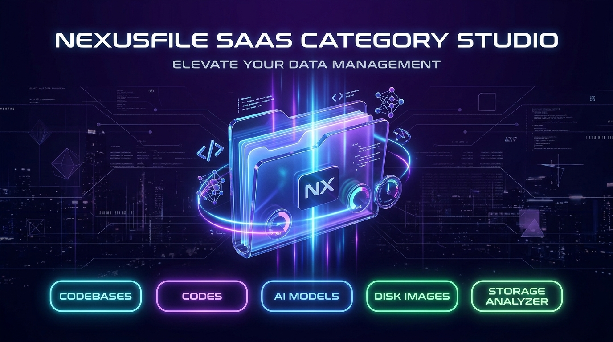
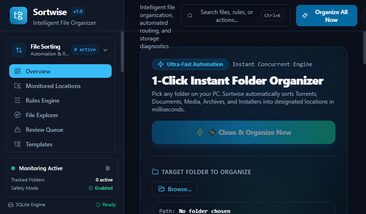
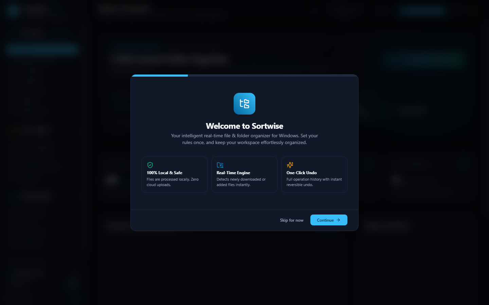
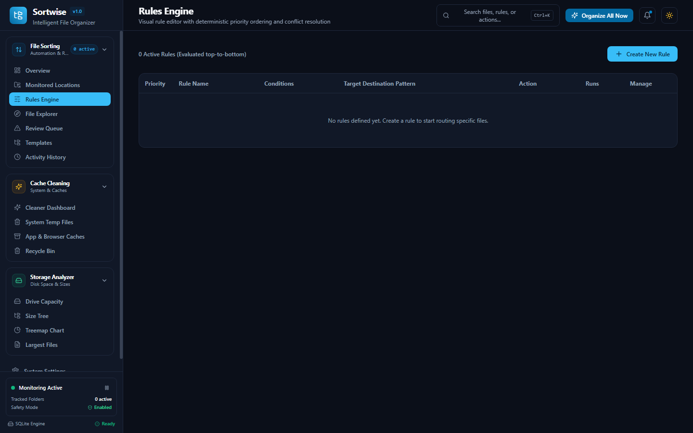
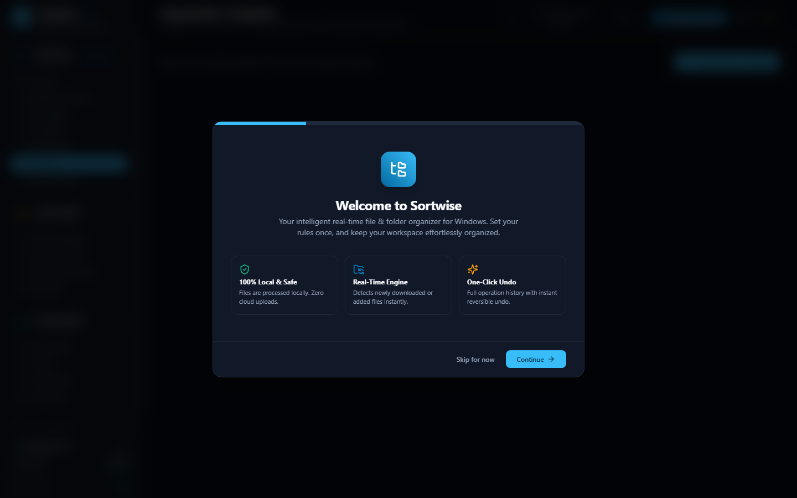
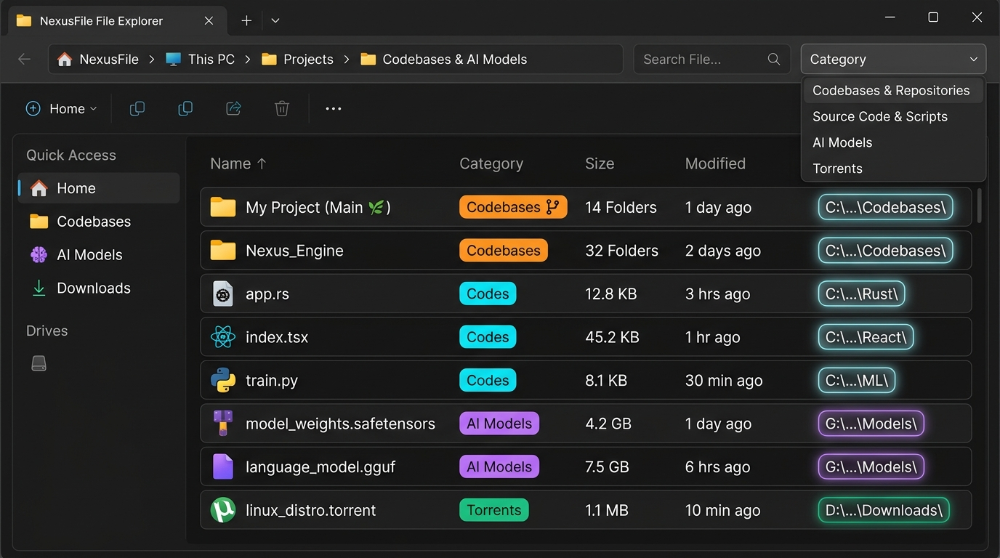

<div align="center">

# ⚡ NexusFile
### High-Performance Automated File Management & Deep Storage Studio for Windows

[](https://github.com/aseerawsaf45-dev/NexusFile)
[](https://github.com/aseerawsaf45-dev/NexusFile)
[](https://nextjs.org)
[](https://www.electronjs.org)
[](https://sqlite.org)
[](LICENSE)

<p align="center">
  <b>Set your rules once. Keep your drives pristine, lightning fast, and organized automatically.</b>
  <br />
  A local-first, privacy-respecting Windows utility engineered with a high-performance native Rust engine, real-time filesystem watchers, interactive disk space treemaps, and zero data-loss safety barriers.
</p>

[Key Features](#-key-features) • [Visual Tour](#-visual-tour) • [Architecture](#-architecture) • [Quick Start](#-quick-start) • [Safety First](#-zero-data-loss-guarantee) • [Tech Stack](#-tech-stack)

</div>

---

## 🎬 SaaS Category Studio & Product Motion Reel

[](https://github.com/aseerawsaf45-dev/NexusFile)

NexusFile includes a built-in **Interactive SaaS Category Video Studio** with 60 FPS motion animations, real-time narration subtitles, audio synthesizer chimes, dynamic scene scrubbing, and instant **WebM video export** via HTML5 MediaRecorder.

▶️ **[Download / Watch SaaS Category Demo Video (MP4, 1080p)](docs/NexusFile-SaaS-Categories-Demo.mp4)**

---

## 📸 Visual Tour

### 1. Modern Control Center & Instant 1-Click Folder Organizer
Monitor any number of active directories in real-time or sort messy folders (Downloads, Desktop, Torrent caches) in milliseconds.



---

### 2. Deep Storage Analyzer & Hierarchical TreeMap
Inspect hard drives and SSDs down to the exact byte with fluid visualization, disk capacity meters, and ranked largest files.



---

### 3. Multi-Tier Cache & Temporary Disk Cleaner
Reclaim gigabytes of wasted disk space safely with explicit safety classification (Level A/B/C), file age filtering, and quarantine safeguards.


---

### 4. Visual Priority Rule Engine
Construct intuitive conditional pipelines using AND/OR groups, regex pattern matching, magic byte signatures, and instant dry-run testing.



---

### 5. Smart Organization Templates
Pre-configured and customizable folder organization structures with date formatting (`YYYY/MM`), project keywords, and category bucketing.



---

### 6. Interactive File Explorer & Intelligent Category Classifier
Browse active drives with real-time multi-signal category detection. Accurately identifies entire codebases, granular source code files, AI model weights, disk images, cryptographic keys, and BitTorrent packages with proposed routing paths.



---

## 🌟 Key Features

### ⚡ Real-Time Directory Monitoring & Stability Queues
- **Native Filesystem Watchers**: Instant notification when files are dropped, created, or modified.
- **Adaptive Debounce & Stability Engine**: NexusFile verifies file lock state and stability (size & modified timestamp checks) before executing any rule, ensuring downloads, torrents, or file extractions are never touched prematurely.

### 🧠 Multi-Signal File & Directory Classification (Magic Bytes + Codebase Markers + Metadata)
- **Directory & Codebase Probing**: Identifies complete software repositories and project directories by inspecting root markers (`.git`, `package.json`, `Cargo.toml`, `pyproject.toml`, `go.mod`, `pom.xml`, `CMakeLists.txt`, `Makefile`, `.sln`).
- **Deep Magic Byte Verification**: Reads raw byte signatures (GGUF AI quants `0x47475546`, WebAssembly `0x0061736d`, SQLite `SQLite format 3`, BitTorrent bencode, PE executables `MZ`, PDF, ZIP, 7Z, RAR, PNG, JPEG, WEBP, MP3, FLAC) to identify files accurately regardless of spoofed extensions.
- **Smart Developer Heuristics**: Distinguishes extensionless build files (`Dockerfile`, `Makefile`, `Procfile`), AI checkpoints (`*safetensors*`, `*checkpoint*`), and cryptographic SSH identities (`id_rsa`, `id_ed25519`, `.pem`).

### 📊 Comprehensive Storage Analyzer
- **Direct Windows API Probing**: Live query of logical disks (`Win32_LogicalDisk`) showing total capacity, used space, free space, and filesystem type (NTFS, FAT32, exFAT).
- **Hierarchical Size Tree & Interactive TreeMap**: Color-coded categorization with interactive depth navigation.
- **Top 50 Largest Files Explorer**: Filter by minimum size (>100MB, >1GB), age, and file type with instant Explorer reveal.
- **100% Read-Only Safety**: Guaranteed zero writes, moves, or deletes during analysis.

### 🧹 3-Tier Safe Cache & Temp Cleaner
- **Level A (Safe)**: Windows user temp directories, thumbnail cache leftovers, and log dumps older than the configured threshold (default 7 days).
- **Level B (Review Recommended)**: Application caches, crash dumps, and browser cache temp files.
- **Level C (Strictly Protected System Areas)**: Windows operating system cores, drivers, fonts, and user document folders are locked against any automated purge.
- **Quarantine Before Deletion**: Move files to a safe, recoverable local quarantine before final removal.
- **Recycle Bin Integration**: Safe emptying with live item count and storage reporting.

### 🛡️ Zero Data Loss Guarantee
- **Smart Collision Policies**: Choose between **Keep Both** (smart numbered suffix `report (1).pdf`), **Skip**, or **Overwrite with Confirmation**.
- **1-Click Reversible Undo**: Built-in undo log records file source, destination, timestamps, and SHA-256 hashes to restore items to their original locations instantly.
- **System Defense Barriers**: Built-in detection for loop movements, path traversals (`..`), and protected Windows system paths (`C:\Windows`, `C:\Program Files`, System32).

### 🪟 Native Windows Desktop Experience
- Runs silently in the background with Windows System Tray integration.
- Single-instance locking (prevents duplicate running processes).
- Quick Command Palette (`Ctrl + K`) for instant search and navigation.
- Dark / Light theme options with high-contrast tabular typography and smooth micro-interactions.

---

## 🏗️ Architecture

NexusFile is designed as a modular monorepo combining low-level Rust systems programming, a high-concurrency Node.js / SQLite backend, and an Electron desktop shell.

```
┌────────────────────────────────────────────────────────┐
│               Electron Desktop Shell                   │
│   (Single Instance Lock • System Tray • Native Menus)   │
└──────────────────────────┬─────────────────────────────┘
                           │
      ┌────────────────────┴────────────────────┐
      ▼                                         ▼
┌───────────────────────────┐      ┌───────────────────────────┐
│     Next.js 14 Frontend   │      │   HTTP / REST Engine      │
│   (React • Tailwind CSS   │◄────►│   (Port 4545 • Fastify)   │
│    Recharts • Lucide UI)  │      └─────────────┬─────────────┘
└───────────────────────────┘                    │
                                     ┌───────────┴───────────┐
                                     ▼                       ▼
                         ┌───────────────────────┐ ┌───────────────────┐
                         │   nexusfile-core      │ │  SQLite WAL DB    │
                         │   (Rust Native Lib    │ │  (Audit logs,     │
                         │    & Regex Engine)    │ │   Rules, Stats)   │
                         │                       │ └───────────────────┘
                         │ • Magic Byte Checker  │
                         │ • Safety Validator    │
                         │ • Priority Evaluator  │
                         └───────────────────────┘
```

For complete architectural details, concurrency models, and database schemas, see [ARCHITECTURE.md](ARCHITECTURE.md).

---

## ⚡ Quick Start

### 🚀 Running the Portable Executable (No Install Required)
You can launch NexusFile instantly with zero setup:
1. Download `NexusFile-Portable.exe` from the latest release.
2. Double-click to run. The app initializes its local SQLite database and opens the control center immediately.

---

### 💻 Developer Setup & Local Build

#### Prerequisites
- **Windows 10 / 11**
- **Node.js** v20.x or v24.x
- **Rust Toolchain** (`rustc` & `cargo`)

#### 1. Clone & Install
```bash
git clone https://github.com/aseerawsaf45-dev/NexusFile.git
cd NexusFile
npm install
```

#### 2. Run in Development Mode
To launch the full desktop environment with hot reloading:
```bash
npm run desktop
```
Or run the web dashboard independently:
```bash
# Terminal 1: Backend Engine & Directory Monitor
npm run server

# Terminal 2: Next.js Frontend
npm run dev
```
Open [http://localhost:3000](http://localhost:3000) in your browser.

#### 3. Run Automated Tests
```bash
# TypeScript / Vitest unit tests
npm test

# Native Rust engine test suite
npm run rust:test
```

#### 4. Build Standalone Portable Executable
```bash
npm run build:portable
```
The output executable will be created in `dist/NexusFile-Portable.exe`.

---

## 🗂️ Default File Categories

NexusFile classifies over 200+ file formats and directory structures across dedicated high-efficiency groups:

| Category | Primary Extensions & Signatures | Description |
|---|---|---|
| **Codebases & Repositories** | `.git`, `package.json`, `Cargo.toml`, `pyproject.toml`, `go.mod`, `.gitbundle`, `.whl`, `.crate`, `.gem`, `.vsix` | Full software project roots, workspace packages, and repository bundles |
| **Source Code & Scripts (`Codes`)** | `.rs`, `.ts`, `.tsx`, `.js`, `.py`, `.go`, `.c`, `.cpp`, `.cs`, `.java`, `.kt`, `.swift`, `.rb`, `.php`, `.sh`, `.ps1`, `.sql`, `Dockerfile`, `Makefile` | Multi-language source code, shell automation, styling, queries, and build definitions |
| **AI & Machine Learning** | `.safetensors`, `.gguf`, `.onnx`, `.pt`, `.pth`, `.bin`, `.ckpt`, `.tflite`, `.h5`, `.keras`, `.mlmodel`, `GGUF` | Neural network weights, tensor checkpoints, quantized models, and inference graphs |
| **Disk Images & VMs** | `.iso`, `.img`, `.vmdk`, `.vdi`, `.vhd`, `.vhdx`, `.qcow2`, `.ova`, `.ovf`, `.wim`, `.esd` | Bootable operating system installation media, optical discs, and VM containers |
| **Security & Keys** | `.pem`, `.key`, `.crt`, `.cer`, `.pfx`, `.p12`, `.pub`, `.asc`, `id_rsa`, `id_ed25519`, `.kdbx` | Cryptographic identities, SSL/TLS certificates, SSH key pairs, and credential stores |
| **Documents** | `.pdf`, `.doc`, `.docx`, `.txt`, `.rtf`, `.odt`, `.tex`, `%PDF` | Text documents, office files, manuscripts, and reports |
| **Spreadsheets** | `.xls`, `.xlsx`, `.csv`, `.ods`, `.tsv`, `.xlsm` | Workbooks, financial sheets, and tabular records |
| **Presentations** | `.ppt`, `.pptx`, `.odp`, `.key` | Slide decks and presentation deliverables |
| **Images** | `.jpg`, `.jpeg`, `.png`, `.webp`, `.gif`, `.svg`, `.bmp`, `.raw`, `.cr2`, `.nef` | Digital photographs, vector artwork, screenshots, and web graphics |
| **Videos** | `.mp4`, `.mkv`, `.mov`, `.avi`, `.webm`, `.wmv`, `.flv`, `.m4v` | HD recordings, screen captures, clips, and animation files |
| **Audio** | `.mp3`, `.wav`, `.flac`, `.aac`, `.m4a`, `.ogg`, `ID3`, `fLaC` | Music tracks, podcast streams, sound effects, and lossless masterings |
| **Archives** | `.zip`, `.rar`, `.7z`, `.tar`, `.gz`, `.bz2`, `.xz`, `.tgz`, `.zst`, `.cab` | Compressed file containers and multi-volume archives |
| **Installers & Binaries** | `.exe`, `.msi`, `.msix`, `.appx`, `MZ`, `ELF` | Windows setup executables, portable runtimes, and system binaries |
| **Design & 3D Assets** | `.psd`, `.ai`, `.eps`, `.fig`, `.blend`, `.obj`, `.fbx`, `.stl`, `.gltf`, `.step`, `.dwg`, `.dxf` | Layered graphics, vector artwork, 3D meshes, and engineering CAD models |
| **Data & Databases** | `.sqlite`, `.sqlite3`, `.db`, `.parquet`, `.arrow`, `.feather`, `.jsonl`, `SQLite format 3` | Structured relational databases, columnar analytical tables, and data streams |
| **BitTorrents** | `.torrent`, `d8:announce` | BitTorrent descriptors and decentralized package metadata |
| **Fonts** | `.ttf`, `.otf`, `.woff`, `.woff2`, `.eot` | Digital typography and scalable outlines |
| **E-Books** | `.epub`, `.mobi`, `.azw`, `.azw3`, `.djvu`, `.cbr`, `.cbz` | Digital publications, comic archives, and electronic manuals |
| **Shortcuts & Links** | `.lnk`, `.url`, `.desktop` | Windows shell links and web shortcuts |

---

## 🤝 Contributing

Contributions, feature requests, and bug reports are welcome!
1. Fork the Project
2. Create your Feature Branch (`git checkout -b feature/AmazingFeature`)
3. Commit your Changes (`git commit -m 'feat: Add AmazingFeature'`)
4. Push to the Branch (`git push origin feature/AmazingFeature`)
5. Open a Pull Request

---

## 📄 License

Distributed under the MIT License. See [LICENSE](LICENSE) for details.

---

<div align="center">
  <b>Built for Windows with ❤️ by <a href="https://github.com/aseerawsaf45-dev">aseerawsaf45-dev</a></b>
</div>
